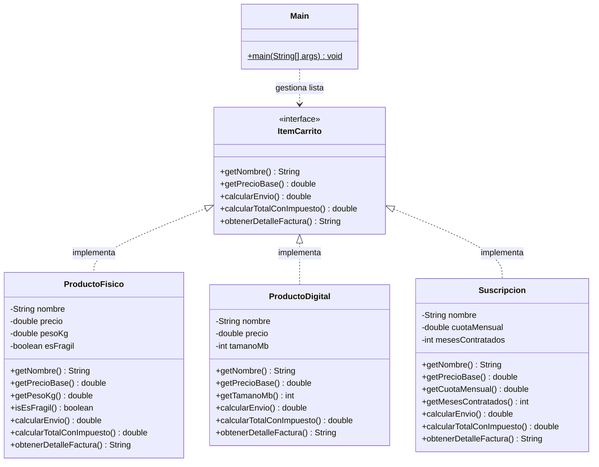
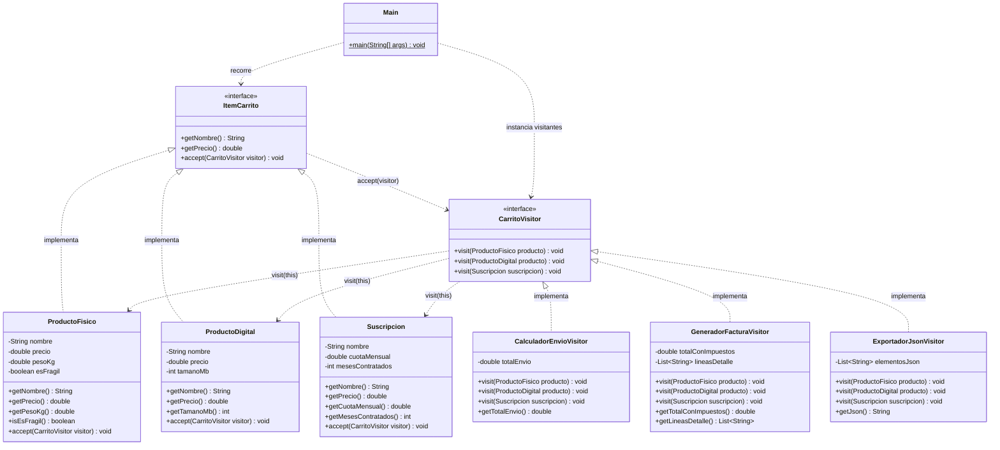

# Diagramas de Clases: Sin Patrón vs Con Patrón Visitor

Este documento contiene los diagramas de clases UML (en formato Mermaid) para contrastar visualmente la arquitectura de ambos enfoques.

---

## 1. Diagrama de Clases: Versión SIN Patrón (`sin_patron`)

En este diseño, la interfaz `ItemCarrito` y cada clase concreta asumen la responsabilidad de calcular costos de envío, impuestos y formatear texto de facturación.

> **Problema visual:** Si se desea agregar una nueva operación (por ejemplo: `exportarAJson()`), hay que modificar **4 clases**: la interfaz y las 3 clases hijas.

---

## 2. Diagrama de Clases: Versión CON Patrón Visitor (`con_patron`)

Aquí la estructura de datos (`model`) se desacopla totalmente de los algoritmos y operaciones (`visitor`). La comunicación se realiza mediante el método `accept(CarritoVisitor)` y el despacho doble (*Double Dispatch*).

> **Ventaja visual:** Si se desea agregar una nueva operación (por ejemplo: `CalcularPuntosFidelidadVisitor`), **ninguna clase del modelo se toca**. Únicamente se crea una nueva clase que implementa `CarritoVisitor`.
