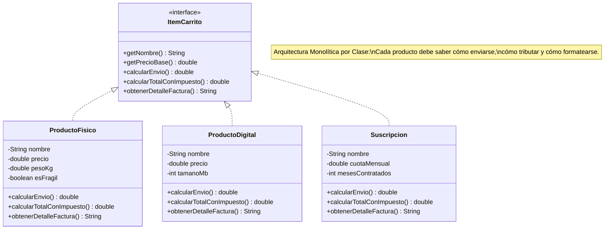
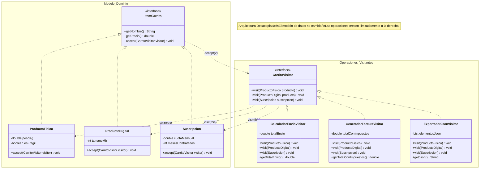
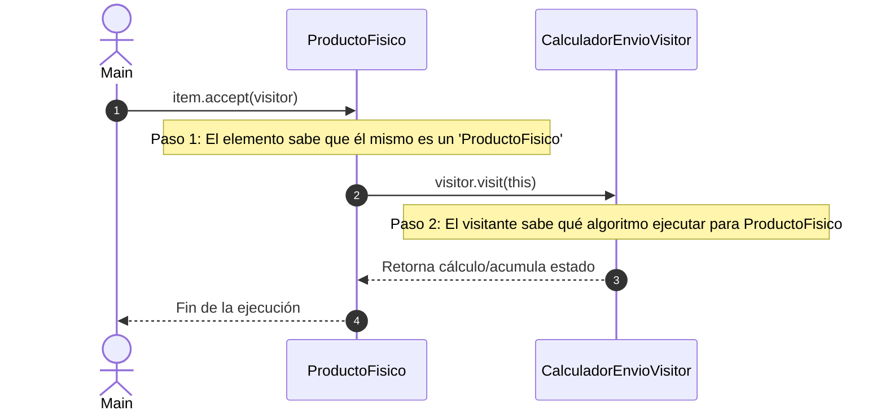

 # Patrón de Diseño Visitor en Java
### *Deuda Técnica vs. Extensibilidad Limpia en un E-Commerce*

---


## 1. El Problema del Negocio

Un sistema de comercio electrónico gestiona 3 tipos de productos en el carrito:
- **Producto Físico:** Requiere cálculo de flete por peso y recargo por fragilidad; paga 19% de IVA.
- **Producto Digital:** No genera flete; paga 10% de impuesto a servicios digitales.
- **Suscripción:** Servicio periódico sin flete; exento de impuestos.

### El dilema arquitectónico:
> ¿Dónde colocamos las operaciones de **calcular flete**, **calcular impuestos**, **generar facturas** y **exportar a JSON** sin convertir las clases de productos en un monolito inmanejable?

---

## 2. Análisis Riguroso de Principios SOLID

### ¿El código con Visitor incumple algún principio SOLID?

| Principio | Estado con Visitor | Análisis Técnico Detallado |
| :--- | :---: | :--- |
| **S** - Single Responsibility (*Responsabilidad Única*) | ✅ **Cumplido con creces** | **Antes:** `ProductoFisico` gestionaba datos de catálogo + tarifas de transportadoras + reglas fiscales de la DIAN + formateo de texto.<br>**Con Visitor:** Cada clase tiene **una sola razón para cambiar**. Si cambian los impuestos, solo se edita `GeneradorFacturaVisitor`. Si cambia la regla de flete, solo `CalculadorEnvioVisitor`. Las clases de productos solo representan datos. |
| **O** - Open/Closed (*Abierto/Cerrado*) | ⚠️ **El gran Trade-off del patrón** | **Para nuevas OPERACIONES:** ✅ **100% Abierto a extensión, cerrado a modificación.** Puedes crear `ExportadorJsonVisitor`, `AuditoriaVisitor` o `PuntosFidelidadVisitor` sin tocar una sola línea de código existente.<br><br>**Para nuevos ELEMENTOS:** ❌ **Se rompe el principio.** Si agregas un nuevo tipo de producto (ej. `ServicioInstalacion`), estás obligado a modificar la interfaz `CarritoVisitor` y **todos** los visitantes existentes para agregar `visit(ServicioInstalacion)`. |
| **L** - Liskov Substitution (*Sustitución de Liskov*) | ✅ **Cumplido** | Cualquier subtipo de `ItemCarrito` (`ProductoFisico`, `ProductoDigital`, `Suscripcion`) puede sustituirse en la colección polimórfica y reaccionar al método `accept(visitor)` sin alterar el comportamiento esperado del sistema. |
| **I** - Interface Segregation (*Segregación de Interfaces*) | ✅ **Cumplido en Elementos**<br>*(Atención en Visitor)* | La interfaz de los elementos (`ItemCarrito`) es diminuta y especializada (`getNombre()`, `getPrecio()`, `accept()`). Ningún elemento está forzado a implementar métodos que no usa.<br>*Nota:* En la interfaz `CarritoVisitor`, si tuvieras 50 tipos de productos y un visitante solo necesitara operar sobre 2, se vería obligado a implementar métodos vacíos. En esos casos se suele mitigar con métodos `default` en Java 8+. |
| **D** - Dependency Inversion (*Inversión de Dependencias*) | ✅ **Cumplido** | El cliente (`Main`) interactúa con abstracciones de alto nivel (`ItemCarrito` y `CarritoVisitor`), desacoplándose de las implementaciones concretas para iterar el carrito. |

---

## 3.  Antes vs. Después: Foco en `ProductoFisico` y sus atributos

Analicemos cómo cambia el diseño cuando nos enfocamos en los atributos de transporte:  
`private double pesoKg;` y `private boolean esFragil;`.

### ❌ ANTES (Sin Patrón): Lógica dispersa y acoplada a la entidad

En la versión sin patrón, la entidad de datos se ensucia con lógica de transporte, lógica tributaria y lógica de presentación:

```java
// Archivo: sin_patron/ProductoFisico.java
public class ProductoFisico implements ItemCarrito {
    private String nombre;
    private double precio;
    private double pesoKg;     // Atributo logístico
    private boolean esFragil;  // Atributo logístico

    // ❌ VIOLACIÓN SRP: La clase de producto calcula fletes logísticos
    @Override
    public double calcularEnvio() {
        double costo = pesoKg * 5.0; // Tarifa fija por kilo
        if (esFragil) {
            costo += 10.0;           // Recargo por manipulación especial
        }
        return costo;
    }

    // ❌ VIOLACIÓN SRP: La clase de producto calcula impuestos fiscales
    @Override
    public double calcularTotalConImpuesto() {
        return precio * 1.19; // IVA 19%
    }

    // ❌ VIOLACIÓN SRP: La clase de producto se formatea a sí misma
    @Override
    public String obtenerDetalleFactura() {
        return String.format("[Físico] %s - Total: $%.2f", nombre, calcularTotalConImpuesto());
    }
}
```
> **Consecuencia:** Si la empresa cambia de operador logístico (ej. cobrar \$7 por kilo o cobrar seguros adicionales por fragilidad), ¡hay que abrir y modificar la clase de catálogo `ProductoFisico.java`!

---

### ✅ DESPUÉS (Con Patrón Visitor): Modelo Puro y Algoritmo Aislado

#### Paso 1: La entidad queda limpia y centrada en su dominio (Model)
```java
// Archivo: con_patron/model/ProductoFisico.java
public class ProductoFisico implements ItemCarrito {
    private String nombre;
    private double precio;
    private double pesoKg;     // Atributo logístico expuesto vía getter
    private boolean esFragil;  // Atributo logístico expuesto vía getter

    public double getPesoKg() { return pesoKg; }
    public boolean isEsFragil() { return esFragil; }

    // ✅ La clase solo cede el control al visitante (Doble Despacho)
    @Override
    public void accept(CarritoVisitor visitor) {
        visitor.visit(this); // 'this' es de tipo ProductoFisico
    }
}
```

#### Paso 2: La regla de negocio se traslada a su propio componente (Visitor)
```java
// Archivo: con_patron/visitor/CalculadorEnvioVisitor.java
public class CalculadorEnvioVisitor implements CarritoVisitor {
    private double totalEnvio = 0.0;

    // ✅ Toda la lógica sobre pesoKg y esFragil reside exclusivamente aquí
    @Override
    public void visit(ProductoFisico producto) {
        double costo = producto.getPesoKg() * 5.0;
        if (producto.isEsFragil()) {
            costo += 10.0; // Manejo especial
        }
        totalEnvio += costo;
    }

    @Override
    public void visit(ProductoDigital producto) {
        totalEnvio += 0.0; // Inmaterial
    }

    @Override
    public void visit(Suscripcion suscripcion) {
        totalEnvio += 0.0; // Servicio
    }

    public double getTotalEnvio() { return totalEnvio; }
}
```

---

## 4. Diagrama 1: Arquitectura SIN Patrón



---

## 5. Diagrama 2: Arquitectura CON Patrón Visitor



---

## 6. Mecanismo Clave: El Doble Despacho (*Double Dispatch*)

¿Por qué Java necesita este mecanismo? Porque Java utiliza **despacho simple**: el método a ejecutar solo depende de la clase del objeto receptor en tiempo de ejecución, no del tipo de los argumentos recibidos.

El patrón Visitor sortea esta limitación en **dos pasos**:



1. **Primer despacho:** `item.accept(visitor)`. Se resuelve polimórficamente qué método `accept` invocar según la instancia real en el carrito (`ProductoFisico`).
2. **Segundo despacho:** Dentro de `accept`, se invoca `visitor.visit(this)`. Como el compilador sabe que `this` es exactamente de tipo `ProductoFisico`, se enlaza con el método `visit(ProductoFisico)` del visitante concreto.

---

## 7.  Conclusiones: ¿Cuándo utilizar el patrón Visitor?

### ✅ ÚSALO CUANDO:
1. **La jerarquía de clases es muy estable** (rara vez agregas nuevos productos o elementos).
2. **Necesitas añadir nuevas operaciones con frecuencia** (reportes, exportaciones, validaciones, etc.).
3. Quieres evitar el anti-patrón de recorrer listas con cadenas interminables de `if (item instanceof ProductoFisico)`.
4. Necesitas que una operación acumule estado mientras recorre una colección heterogénea de objetos.

### ❌ NO LO USES CUANDO:
1. **Tu jerarquía de clases cambia constantemente**: Si agregas nuevas clases de elementos cada semana, tendrás que editar la interfaz `Visitor` y reescribir todos tus visitantes existentes, rompiendo OCP.
2. Si los elementos tienen datos estrictamente encapsulados y no quieres exponer *getters* públicos que violen la privacidad de la clase.
